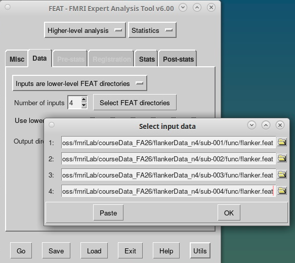
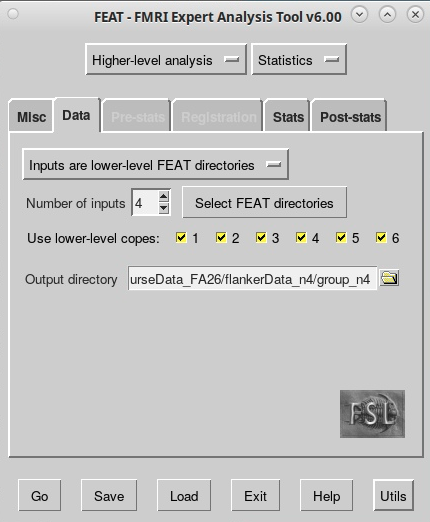
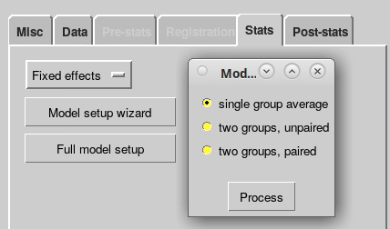
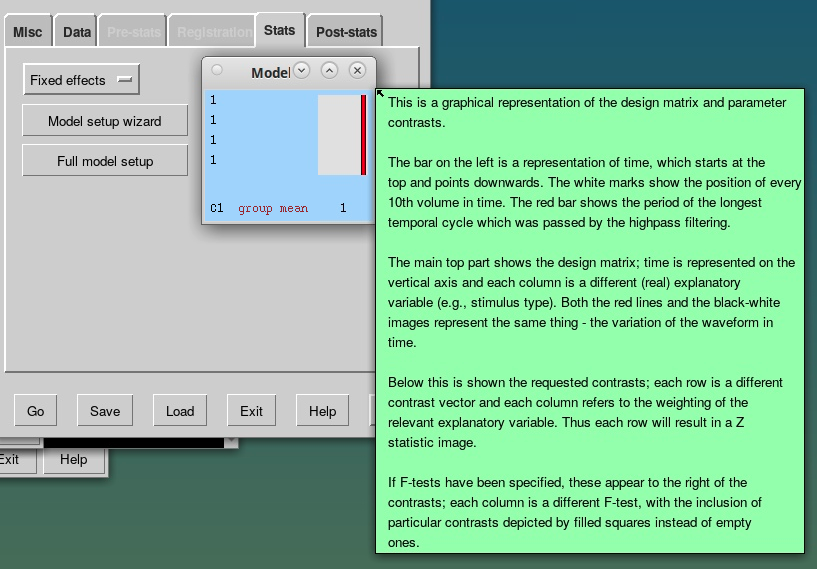
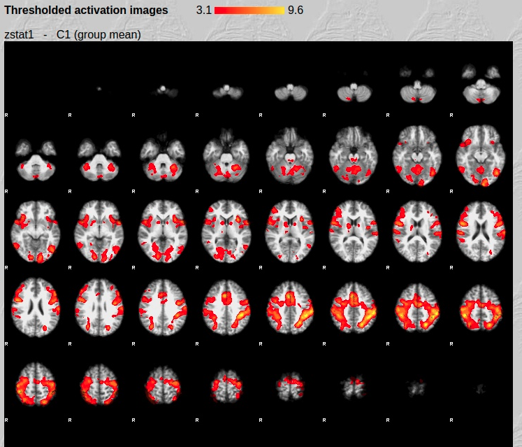
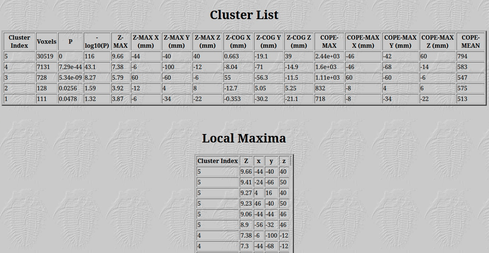

**By the end of this practical you should be able to:**  
* [ ] use the FEAT GUI to create a group-level map of task-related BOLD activation  
* [ ] locate and understand results using the html reports and fsleyes  
 

**Access FastX** through the remote login:  
https://fastx.divms.uiowa.edu:3443/   
 

**Prerequisite**: Before you start group analysis, you should have `flanker.feat` output folders that you created for sub-001, sub-002, sub-003, and sub-004. 
 
 

**Group analysis GUI**: Our group analysis will determine the average activation across subjects for each of our contrasts that we made within-subjects (e.g., con>baseline, neu>baseline, inc>baseline, errors>baseline, inc>nue, con>neu).
*  In terminal, move yourself to your data folder by typing `cd ~/fmriLab/`
*  Type `fsl` and click on `FEAT FMRI analysis`
*  In the top-left menu, select `Higher-level analysis`:  

 

**Set input and output on `Data` tab**: 
*  Keep default of `Inputs are lower-level FEAT directories`
*  Keep `Number of inputs` to 4, because we have 4 subjects 
*  Click to `Select FEAT directories` and select each of your `flanker.feat` folders:  

*  Keep `Use lower-level copes` as default, these are the six contrasts we set for the single-subject analyses
*  Specify output directory to be in derivatives with the name `group_n4`:  

 

**Setup group model on `Stats` tab**:  
*  Select `Fixed effects`, which computes an average generalizable to only this set of participants. This is most appropriate if you have less than 10 subjects.
*  Select `Model setup wizard` and keep the default of `single-group average` and click `Process`:  

 

**Our group model**: Now what does the red line represent? 

 

**Post-stats tab**: all settings here can stay as default.
 

**Click `Go`**: 
*  An html output report will come up in your browser, or you can find it in the output folder you specified
*  Once done, navigate to the `Registration summary` tab and evaluate that input subjects and alignment are what you expect
*  Next, navigate to `Results` and click on `Lower-level contrast 3 (inc)`
*  You should see the map below:  

 

*  Click on the image in the html report, let's talk about the table you see below:  

 
 

## Lab Submission: Evidence of Completion

Submit **two PDFs from your group analysis** to the lab assignment on ICON:

1. **Registration summary:** Print and save as PDF your Registration summary from your Higher-Level FEAT Report. The TA will evaluate if you have all the correct subjects input with the correct brain as under-lay and over-lay.
2. **Completed FEAT report:** The Post-stats section of the `flanker.feat` HTML report for the `con > neu` condition. Print and save as PDF your results summary page for this contrast from your Higher-Level FEAT Report. The TA will check that the analysis completed and that the expected activation map was produced.

